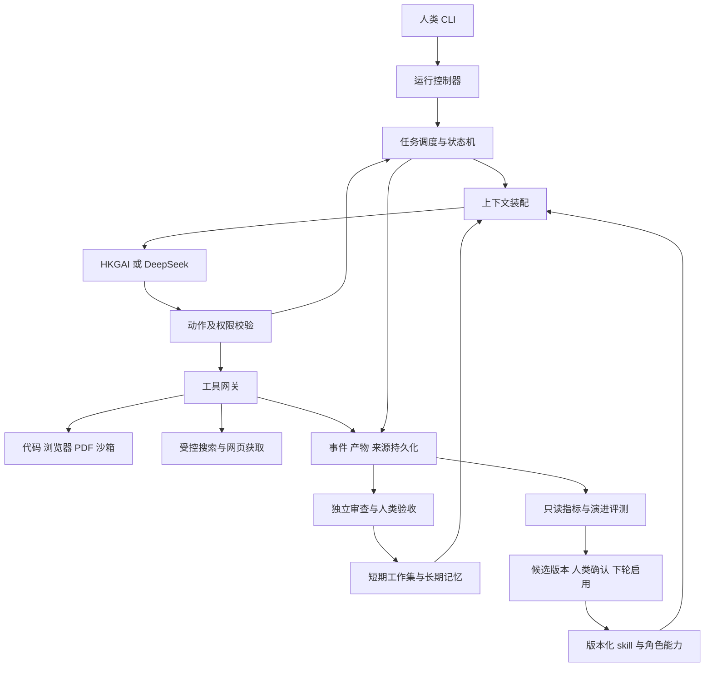

# Campus Collab 技术与架构设计

M3/M4 的实际代码、验证证据和边界见 [实施记录](../m3-m4-implementation.md)，完整记忆管理逻辑见 [记忆管理](../memory-management.md)。下文的设计范围还包含未实施阶段。

- 版本：0.2，设计已确认；日期：2026-11-20。实际进度见 [实施记录](../m0-m2-implementation.md)。
- 基线：`42db55a`；本文所有“新增”“目标”均为设计，不代表已经实现。
- 关联：[PRD](PRD.md)、[实现路线](ROADMAP.md)、[现有契约](../orchestration-contract.md)。

## 1. 技术决策

保留 Python 3.11+、现有 CLI/Engine/Tools/Store 和课程模型客户端，以可替换接口逐步拆分职责。第一版单群组一个写进程、顺序执行一个模型动作；不同任务的独立上下文不等于多个进程并行。

控制面保留文件型存储。`state.json` 是任务、事件、请求、版本绑定和待执行副作用的权威状态；仍使用文件锁及原子替换。新增长期记忆使用追加日志；SQLite 只作为可删除重建的检索索引。先解决一致性和上下文成本，不把整个系统迁移到微服务或向量数据库。

核心保持标准库；浏览器能力放入单独的 Playwright 镜像，PDF 提取放入受限解析镜像。它们不进入核心 Python 依赖，不影响原有纯文本/CLI 运行；需要这些能力的验收项目缺少依赖时显示 `blocked`，不能自动判为通过。具体版本及镜像摘要在对应阶段固定。

## 2. 目标组件与数据流



建议逐步形成以下职责；路径为未来实现建议，不在本轮创建。

- `cli.py` / `runner.py`：统一 `/resume` 入口的参数解析、批次/连续模式、中断和停止原因；runner 是内部组件，不对应新增用户命令。
- `engine.py` / `scheduler.py`：任务契约、依赖、预算、审查和失败传播；不能由 skill 修改。
- `context.py`：权限过滤、证据引用、工作集压缩、token 预算和记忆检索。
- `skills.py` / `skills/<id>/SKILL.md`：注册、版本、适用条件和模板；不含课程题目答案。
- `tools.py` / `tool_registry.py` / `adapters/`：工具策略和适配器；模型不能调用任意 Python 函数。
- `memory.py`：候选、长期经验、反证、过期、共享与索引。
- `evolution.py`：候选补丁、实验、审批及回滚；没有修改核心策略的权限。
- `store.py`：状态版本、锁、原子存储、迁移和幂等副作用队列。
- `report.py` / 现有评测脚本：只读消费记录，不修改任务结果。

## 3. Agent 身份、子任务与派发

### 3.1 身份模型

`role_id` 仍限定为场景原有四角色。新增能力清单只描述角色能做什么，不替换原始提示词。能力可以包含研究、开发、测试、事实核查、风险分析、编辑、发布等；工具权限另行校验，不能因为声明擅长某技能就获得权限。

本设计的“子 Agent”是 `task_id + role_id + context_id` 的任务执行实例：每次请求有独立当前任务、工作集及预算，但复用该角色模型客户端和工作目录。需要文件隔离更细时使用任务子目录；不允许不同上下文在同一文件上交错覆盖。

私有任务是例外：必须使用独立的 private workspace 和 conversation scope，公共任务的文件工具及容器不得访问它。不能仅靠“群聊 prompt 不展示私信”实现私密性，也不能把私信经验直接写入公共任务可检索的角色记忆。

不添加第五个常驻规划者、批评者或反思者。计划、审查、反思是既有角色执行的不同任务类型；独立审查者必须与被审查负责人不同，且不得参与该交付版本的编写。人类验收始终独立。

### 3.2 目标任务契约

以下为 v2 示例，字段尚未实现；原 `id/owner/run/criteria/depends_on` 等保留。示例 ID 不表示实际运行记录。

```json
{
  "schema_version": 2,
  "id": "t2",
  "run": "r1",
  "parent": "t1",
  "owner": "dev",
  "kind": "work",
  "description": "实现已确认的预约交付",
  "criteria": ["同房间重叠预约被拒绝", "重启后记录保留"],
  "depends_on": [],
  "inputs": [{"bundle_id": "b_requirements", "digest": "sha256:<digest>"}],
  "outputs": {"kind": "source_bundle", "required_paths": ["README.md"]},
  "required_capabilities": ["software_build"],
  "skill_refs": [{"id": "software.build", "version": "1.0.0"}],
  "allowed_tools": ["files.*", "code.run", "artifact.publish_bundle"],
  "context_scope": "group_public_and_self",
  "budget": {"max_actions": 60, "deadline_seconds": 1800},
  "attempt": 1,
  "revision": 1,
  "status": "running"
}
```

`allowed_tools` 是策略集合的子集，不允许模型自行拓宽。父/子动作预算采用双重约束：每次请求消耗当前任务及根运行预算，子预算预留总额不得突破根预算；重试和反思也计入。现有 360 次根预算是初始上限，按实验调整，不能靠 `/resume` 重置。

### 3.3 派发算法

1. 根任务先通过 plan；验收条件变化需保留新 revision 和变更理由，提交后不能静默降低标准。
2. 模型提出 delegate，包括目标、角色、验收、输入和依赖。角色能力注册表提供候选建议；首版不由隐藏分类器强制分配。
3. 调度器校验角色、输入可见性、产物摘要、依赖存在、无环、深度/节点/动作预算及重复交付键。
4. 校验和创建在同一次状态保存中完成。被拒绝委派不留半个节点；仅文本“我让 QA 检查”不生成任务。
5. 有依赖则等待；所有依赖必须是审查通过的 `completed` 才进入就绪队列。失败依赖需要显式处理，不能永远等。
6. 取出就绪节点，装配当前角色上下文；模型每轮只返回一个结构化动作。
7. finish 固定提交集合、版本及证据，创建独立审查节点；审查节点禁止继续委派。
8. 通过后解锁父/依赖；拒绝进入同一任务的新 attempt。三次返工用尽后标为失败并传播。
9. 根审查通过创建 acceptance 请求；人类批准后运行才计为成功。

重复判定使用显式 `deliverable_key + parent + input_digest + revision`，不能只凭语义相似就把合法新任务合并。更换负责人需记录交接原因，不能借交接绕过返工次数。

### 3.4 状态与执行控制

沿用既有任务状态：`running`、`waiting_for_children`、`waiting_for_dependencies`、`waiting_for_human`、`reviewing`、`completed`、`failed`。新增运行控制字段与这些状态分开：`stop_reason`、`active_task`、`last_progress_at`、`retry_at` 和是否存在活跃执行进程。

执行控制统一通过 `/resume`，不另设同功能命令。以下为待实现的命令契约：

- `/resume`：兼容现有习惯，默认最多执行 30 个模型动作。
- `/resume N`：分批执行，最多 N 个动作，仍受现有单批上限及剩余总预算限制。
- `/resume --continuous`：在同一次调用中自动执行多个内部批次，不因批次边界停下；每个动作前检查任务/根预算和停止条件。

N 与 `--continuous` 互斥；非法组合在调用模型前拒绝。单批上限约束内部调度粒度，不能被误当成连续执行的总上限；连续模式也不能借内部换批重置根/任务预算。

两种模式在启动前检查既有待处理人工请求，在每个动作后检查新请求；存在请求时交回控制权，即使其他任务就绪，也先展示请求与等待状态。不得对 clarification/approval/acceptance 自动回答；人类处理请求后再次使用 `/resume` 选择分批或连续执行。

连续模式只在当前前台调用期间有效，不创建无人知晓的后台循环；用户中断或进程退出后保存可恢复进度，下次启动不自动续跑。

停止原因至少区分：本批次结束（仅分批模式）、人工等待、完成、可重试错误重试耗尽、不可恢复错误、无进展、依赖失败、预算耗尽、用户中断。展示执行模式、实际动作数、已用/剩余预算、相关任务/请求 ID 和下一步操作。预算耗尽不能建议重复执行 `/resume` 来绕过上限；完成时不再派发任何动作。批次结束不是错误；持久化 `running` 不表示现在仍有后台进程。

无进展初始建议：同一任务连续 5 次无新有效输出的重复读取/重复报错后暂停并给出诊断；阈值配置化。合法的分段读取需要不同内容范围，不能仅按工具名认定重复。

## 4. Skill 设计与工作逻辑

### 4.1 Skill 定义

仓库内 runtime skill 的 `SKILL.md` 是平台自己的声明文件，不是本次 Codex 会话的宿主技能。首版用 JSON manifest 加 Markdown 正文，避免强制增加 YAML 依赖。manifest 包含：

`id`、`version`、`description`、`applicability`、`compatible_roles`、`input_schema`、`output_contract`、`required_tools`、`forbidden_operations`、`review_checks`、`content_sha256`。

skill 正文包含前置条件、建议步骤、异常分支、证据要求和反例。`skill.use` 返回审核通过版本的内容和元数据，记录到当前任务；不会自动执行正文中的命令。任务内固定版本，最终调用工具仍经引擎策略校验。

### 4.2 首批 skill 目录

- **`requirements.clarify`**：所有负责人/客户沟通角色使用。输入目标及未确定事项；区分必须询问的风险约束和可声明的低风险假设；输出需求记录、开放问题及需求 revision。缺少投资风险偏好等关键输入时必须询问。
- **`orchestration.plan_delegate`**：所有工作角色可用。输入需求和能力清单；提出可核查条件、交付物和 DAG，检查循环/重复；输出 plan/delegate 动作，不能直接修改 state。
- **`software.build`**：开发角色为主。输入需求、数据契约和前版交付；分块实现、运行测试、保留取消历史和兼容接口；输出完整源码集合及运行说明，不只输出 ZIP。
- **`software.verify`**：未参与当前交付编写的角色使用。从干净集合安装/启动，验证边界、并发、持久化和浏览器行为；输出逐项检查与真实证据，不把零测试或 HTTP 200 当完整通过。
- **`delivery.release`**：发布/编辑/沟通角色使用。检查 manifest、版本、启动方式、限制和来源；输出可复现交付；外部推送单独申请审批。
- **`research.traceable`**：记者、研究员及事实核查角色使用。搜索发现 → 打开正文/PDF → 记录时间和片段 → 构建来源台账；未获取正文的来源降级标注，不能编造核验。
- **`research.fact_check`**：事实核查/风险/未参与编写的审查角色使用。拆分论断，找支持与反证，比较方法和时间，标明无法确认项；输出 claim-to-source 对照和结论边界。
- **`writing.evidence_based`**：编辑、主编和沟通角色使用。保留论断出处，按读者和渠道改写；不添加不存在的采访、价格和事实。
- **`finance.portfolio`**：基金经理和研究角色使用。输入已确认偏好、日期化数据和汇率；计算权重、金额、现金及费用，风险角色独立复核；不输出真实交易动作。
- **`finance.industry_analysis`**：研究/风险角色使用。划定产业链、需求和政策范围，区分事实及情景，主动寻找反证；输出研究与风险备忘录。
- **`presentation.html`**：编辑/沟通角色使用。输入已审核内容及来源；生成离线 HTML、逐页/键盘导航及引用；输出可展示文件和浏览器验证证据。
- **`learning.reflect`**：既有角色在失败或验收后使用。输入事件、证据和结果；输出简短经验候选及适用边界，不记录隐式思维链，不直接覆盖 prompt。

每项 skill 都允许模型跳过不适用步骤并解释原因；强制约束来自引擎，不来自自然语言模板。六题与这些 skills 的对应关系见 PRD 第 5 节，技能组合不限制于六题。

## 5. Tools 注册与执行协议

### 5.1 公共契约

注册项至少包含 `name/version/input_schema/output_schema/permissions/network/approval/timeout/output_limit/side_effect/retry_policy`。未知参数、非法路径和越权在执行前拒绝；当前任务允许的工具才进入 prompt。角色权限、任务权限、skill 声明与全局策略取交集。

新工具统一返回以下形状；旧工具通过兼容适配器归一化，不一次性改变现有假模型测试协议。

```json
{
  "ok": true,
  "data": {},
  "error": null,
  "warnings": [],
  "evidence": {
    "group": "software",
    "run": "r1",
    "task": "t4",
    "attempt": 1,
    "producer": "qa",
    "seq": 120,
    "subject_digest": "sha256:<tested-bundle>"
  },
  "truncated": false,
  "retryable": false
}
```

`error` 至少有稳定 code、可展示 message 和是否可重试。输出过长保留受控 blob 引用及摘要，不截断成“通过”。`ok=true` 只表示工具执行成功，不表示测试断言通过或事实结论正确。证据绑定当前 task/attempt 与输入摘要，版本变化使对应验证失效。

新工具使用 `idempotency_key` 识别同一写操作重试；它不意味着 GitHub 等外部服务具有精确一次语义。

### 5.2 保留及增强的工具

- **`files.list/read/write/append/replace/delete`**：保留相对 POSIX 路径、禁止链接/越界及大小限制；增加机器可读允许格式和受限分页读取。delete 继续审批。写入同一内容不能当作新的实质进展。
- **`code.run`**：继续只在当前角色 Docker workspace 执行，默认无网络。结构化记录退出码、测试发现数、超时和输出截断；发现零测试触发警告。
- **`ui.check`**：保留宿主 Node 静态解析，不执行产物代码；支持从 HTML/Python 字面量提取 JS。结果不能替代浏览器点击测试。
- **`web.search` / `web.fetch`**：保留真实搜索和 HTTPS 公网验证、逐跳检查及连接 IP 校验。补充来源版本、发布日期、访问日期、内容摘要及来源类别。模型 key 不传给搜索服务。
- **`artifact.publish/import`**：继续支持旧单文件动作；校验哈希及可见范围。
- **`git.init/status/diff/commit/push`**：保留容器内操作，push 继续单次人工审批及临时凭据；不继承工作区 hooks。实现侧不得将直接执行 `code.run` 变成另一条未审批联网通道。

审批保证的范围必须说清：显式 `files.delete` 可要求确认，但任意生成代码在可写 workspace 内也能删除自己的文件，因此不能宣称“所有工作区删除都会被审批”。不可变交付、历史证据及私有目录放在代码执行挂载范围之外；数据迁移针对快照和单独授权的副本，避免将真实业务数据作为普通可写源码目录挂载。

### 5.3 新增 P0 工具

- **`skill.list` / `skill.use`**：输入能力过滤或 `id/version`；返回当前角色允许的审核版本；只读，不增权。
- **`artifact.publish_bundle`**：输入显式 paths、description、entrypoints、data_contract 和版本标签；最多 100 个文件、初始总上限 10 MB、每个文本文件继续 256 KB。逐个验证后写入 blob，再原子提交 manifest 引用；失败不暴露半个集合。默认不发布 `.env`、`.git`、数据库、压缩包或密钥。
- **`artifact.import_bundle`**：输入 bundle_id、目标相对目录；核对所有哈希及输入许可后写入临时目录，再切换为目标版本。出现路径冲突需明确策略，禁止悄悄混入旧文件。
- **`artifact.validate_bundle`**：输入 bundle_id；校验路径、摘要、必需文件及静态脚本；返回结构化缺项，不代替 QA。

批量调用算一次调度动作，但每个文件仍记录处理结果、字节数及哈希。超限要求拆分成可追踪多个集合，不通过 ZIP 绕过限制。

### 5.4 新增 P1 研究与验证工具

- **`browser.verify`**：输入已导入 bundle、允许入口和声明式检查（导航、填写、点击、文本/状态断言、键盘）；输出检查步骤、控制台错误和证据。应用与浏览器在同一受限容器内运行，只访问容器本机预定端口，默认禁外网、文件 URL、下载和任意 JavaScript evaluate。需要自定义测试代码时走已隔离的 code.run，而不是宿主浏览器。
- **`preview.start/stop`**：受控预览管理器启动选定交付，仅映射宿主 `127.0.0.1`；只读源码、独立数据、不注入秘密、记录 lease/容器名/端口并可回收。首次暴露本机端口及更换交付需明确人工同意；用户手工运行已知预览命令也作为主动操作。不能把外部部署混进本地预览。
- **`web.fetch_document`**：仅从经公网验证的 HTTPS 下载 PDF，大小初始上限 20 MB；禁止带凭据 URL，重定向和实际连接仍逐次验证。下载进入研究暂存区，不允许模型指定宿主路径。
- **`document.extract`**：输入已登记 document_id，离线容器解析 PDF，限制时间/内存/页数（初始 100 页）；返回页码、文本片段、提取质量和摘要。扫描件无文字时明确失败，OCR 后续可选；解析程序和原文件不在宿主执行。
- **`evidence.record_claim` / `evidence.list_claims`**：输入论断、来源片段、支持/反对/未知关系、时间及局限；记录 claim ledger。只接纳已登记来源 ID，不能凭空创造来源；关系由人/模型判断，工具仅校验结构与出处。
- **`data.register`**：输入可见的 CSV/JSON 产物或受控 SQLite 只读快照及 provenance；登记 dataset_id、schema、时区、币种、观察日期、哈希和授权范围。控制面 state、秘密和其他角色目录不是可登记数据集。
- **`data.analyze`**：输入 dataset_id 与有限操作 spec，例如计数、区间裁剪汇总、取消率、分组、Decimal 金额/权重校验和显式压力情景；返回公式、参数、输入摘要和结果。首版不开放任意 SQL/表达式 eval；复杂分析走沙箱代码并记录输入快照。统计助手只复算，不替代研究判断或实时行情来源。

控制面数据库/原始预约数据库不进入默认文本产物。需要跨角色传递数据时，由 data.register 在授权范围内产生脱敏 CSV/JSON 快照并发布；本机预览由受控管理器挂载独立运行数据。每次数据变更生成新 dataset 版本，不能继续引用旧分析结果。

### 5.5 记忆和演进工具

- **`memory.search` / `memory.inspect`**（P1）：按角色、任务及权限过滤后检索；返回适用范围、状态、证据引用和命中原因；不返回其他角色私信。
- **`memory.propose` / `memory.challenge`**（P1）：提出经验或反证，不能直接把候选标成可靠事实；写入候选及后续校验事件。
- **`memory.share`**（P1）：提出向群组共享可见经验的请求，经过敏感性/权限检查，私信派生内容必须由授权人确认；共享的是脱敏内容和允许公开的出处。
- **`evolution.propose` / `evolution.evaluate`**（P2）：前者只产生允许字段的候选补丁，后者创建隔离实验任务，消耗专用预算；都没有正式启用权限。

`memory` 提升、`evolution promote/rollback` 和策略设置属于引擎/人类管理接口，不作为 Agent 可任意调用的增权工具。审批记录绑定候选摘要，修改后必须重新评估和确认。

## 6. 上下文与短期记忆

### 6.1 内容及生命周期

每任务工作集记录：当前目标和验收 revision、已确认人类约束、依赖与输入版本、最近有效动作、待验证假设、未解决问题、工具结果摘要和相关来源。状态保存在任务记录或可重建缓存中，进程退出不丢失。

原始工具结果、消息和产物仍是证据源；工作集摘要不是证据。保存简短决策及依据，不要求模型暴露或长期保存隐式思维链。

### 6.2 Prompt 装配顺序与预算

有效约束由宿主策略、当前任务授权及未修改的原始角色共同确定；可演进 overlay 和 skill 只补充工作方法，网页/工具/记忆均作为带来源的数据块。任何冲突先按引擎硬约束拒绝，不能依靠 prompt 排序来保障权限。

初始输入预算建议 24,000 tokens，输出上限维持配置值；按模型实际上下文、价格及验证结果调整。建议预算：固定规则/角色 15%、任务及需求 20%、近期有效事件 25%、长期记忆 15%、按需证据片段 20%、余量 5%。关键约束优先保留，超限通过外部引用及分页，不删除待审批事项。

模型无 tokenizer 接口时先用保守字符估算并校准，标记 `estimated`；不能把估计当真实 token。每次记录各块估计量、检索 ID 和摘要版本。

压缩必须保留否定约束、日期、币种、接口、需求来源和证据 ID；变更需求、返工或更换输入时重建工作集。若摘要与原始来源矛盾，以原始记录为准并修复摘要。

## 7. 长期记忆模型与管理

### 7.1 记什么、不记什么

- **情节记忆**：某次任务/失败/返工的简短记录，包含输入条件、行动、结果与证据。例如“某版本 HTML 的 Python 转义使按钮失效”。
- **语义记忆**：有日期/范围的事实或接口，如已确认的预约数据 schema、用户在当前项目确认的时区。易变市场数据必须带截止日，不能当作永久知识。
- **程序性记忆**：可复用办法，例如浏览器与 API 应分别验证、从干净目录检查交付完整性；稳定后可提出 skill 改进。

不保存密钥、完整网页/源码副本、未获授权的个人财务细节或模型隐式推理。原始资料用受限 ID 引用；失败记录不是全盘拒绝经验的理由，但必须区别事实、假设和待验证建议。

### 7.2 记录结构

```json
{
  "memory_id": "m_001",
  "version": 1,
  "group": "software",
  "owner": "dev",
  "visibility": "role_private",
  "origin_scope": "group_public",
  "conversation_id": null,
  "kind": "procedural",
  "content": "发布浏览器应用前分别运行 JS 静态检查与真实点击验证",
  "scope": {"capabilities": ["software_build"], "conditions": ["包含浏览器 UI"]},
  "status": "candidate",
  "outcome": "review_rejected",
  "support_refs": [{"run": "r1", "task": "t2", "seq": 108}],
  "counter_refs": [],
  "created_at": "<UTC ISO8601>",
  "valid_until": null,
  "supersedes": null,
  "prompt_version": "overlay-0",
  "skill_versions": ["software.build@1.0.0"]
}
```

支持证据与结果标签单独存在；不能凭 `human_accepted` 认为每个教训都正确。首版可靠性使用可解释的状态和支持/反对计数，不输出伪精确置信概率。

### 7.3 写入、提升、纠错与遗忘

1. 工具失败、审查拒绝、人工反馈或验收结束触发去重的反思候选。简单格式错误可由规则分类，不必每次再调用模型。
2. 校验候选 JSON、来源存在、任务/角色权限和适用范围；失败原因需要引用失败证据，正向做法需要引用实际成功验证。
3. 同内容/条件候选合并支持出处；相互冲突的内容同时保留并标记，不能简单“最新覆盖最旧”。
4. 经独立复核可为 `peer_validated`；稳定跨任务经验可由人类确认后成为 `active`。角色自己的验证只能作为支持，不能自我提升成已独立复核。
5. 人类拒绝或新反证使相关 active 记忆进入 `disputed`，默认检索不作为正向指导；确定错误后 `superseded/retracted` 并指向修正记录。历史保留，不能删除失败证据来提高命中率。
6. 超期信息为 `expired`，只可用于历史说明。来源撤回、schema/代码版本变化也可触发失效，不只靠日期。
7. 用户隐私删除通过 tombstone、缓存/索引清除及必要物理删除执行；普通状态撤销与隐私删除不是同一操作。默认 role-private，跨场景不共享个人偏好。

初始保留策略：工作集在任务结束后退出活跃检索，保留引用供复核；原始运行证据遵循实验保留策略。易变金融信息默认下一次研究重新确认；稳定方法可不设固定 TTL，但有版本适用条件。个人偏好保留期限由用户决定，未确认时只在当前群组使用。

### 7.4 检索

先执行群组/角色/原始会话可见性和 status/有效期过滤，再按能力、条件、关键词/BM25、证据等级与新近性排序，最后去重并限额。`role_private` 只限定角色，不能覆盖 `origin_scope`：私信派生记忆只在对应 private conversation 内召回，不进入该角色的公共任务上下文。默认最多 6 条与当前任务相关的长期记忆，不为了凑数量返回无关内容。

SQLite FTS5 如不可用，退回确定性的关键词检索；中文用基础分词规则/字符 n-gram 并单独评测。向量检索作为后续可选适配器，只有在同一权限和质量评测通过后启用，不是首版必需服务。

共享记忆放在独立群组公开日志，含批准人及公开出处；不能将私有记忆复制到公共向量索引再在 UI 隐藏。检索缓存键必须包含作用域、版本和失效 revision。

### 7.5 一致性与恢复

`state.json` 同一次原子保存写入批准事件及 `memory_outbox` 项；日志追加使用确定性 `operation_id`。写入长期日志成功后再标记已投递。若进程在两步之间崩溃，恢复后按 operation_id 重放，日志读取和索引按 ID 去重；不得重复计支持次数。

长期记忆追加日志保存内容版本和状态变更，不原地覆盖旧事实；SQLite 是派生索引，可从日志重建。损坏的末尾不完整记录隔离并报警，不静默丢弃全部记忆。工具批准和正式 prompt 提升也需要在状态事件中绑定明确摘要。

## 8. Prompt 与其他自进化

### 8.1 可演进面与不可变面

可演进：角色附加工作指导 overlay、skill 推荐步骤/反例、检索权重、压缩阈值、在既有权限内的角色匹配建议。

不可自动修改：原始角色提示词、原始六题、审批与隔离、工具权限、硬预算、验收条件、完成率分母、独立审查规则及评测程序。新增工具实现是工程变更，不是 prompt 候选的一部分。

单次只改变一种变量，避免 prompt、记忆、skill 同时变化后无法判断收益来源。运行绑定 `policy_version/prompt_overlay/skill_versions/retrieval_version/memory_snapshot`，正式实验期间不热切换；回滚只影响后续任务，不改写已产生结果。

### 8.2 演进闭环

`observed → proposed → validated → evaluated → awaiting_approval → promoted`，分支终态为 `rejected/rolled_back`。这里是 evolution 对象状态，不与工作任务状态混用。

1. 从失败聚类、人工纠错或重复操作提案，记录原因和支持/反对证据。每个候选只修改白名单文件/字段。
2. 静态检查角色冲突、越权文字、无来源结论、密钥/隐私、依赖版本及长度；自然语言扫描仅为补充，权限仍由引擎执行。
3. 在新的隔离实验 runtime 中验证，固定模型、输入数据、初始记忆和 budgets，baseline/candidate 各自独立运行。
4. 先通过所有不变量及离线回归，再做开发集上的配对试验：初始每场景至少两个开发变体、各 3 次重复；提供商不支持 seed 时注明，随机交错执行顺序并报告原始结果。
5. 硬性规则：安全/隐私不变量零退化、各场景成功数不低于基线、人工质量评分不下降；同质量条件下 median 动作/token 不超过基线 110%。质量明显提升但更贵的候选单独交由人类权衡，不能自动破例。
6. 样本少时只给趋势与原始分布，不声称统计显著。提供商 token 不完整时报告未知费用，不用零填充。
7. 评估者不知道候选名称，人工最终验收仍由真实人类执行；自动 judge 只是辅助，不允许候选给自己最终打分。
8. 人类确认候选摘要及报告后，在下一次新运行提升默认版本；出现约束冲突、跨任务质量下降或预算异常，停用并回到前版本，保留全部记录。

演进有独立动作/调用预算、候选数量和人工确认上限；初始每轮最多 2 个候选，每个实验任务仍受 360 次根上限约束。正式六题和未公开隐藏测试不作为候选选择/调参数据；使用开发变体，正式评测冻结版本。

### 8.3 其他演进的优先顺序

先做任务内错误纠正和有证据记忆，再做跨任务失败反思与程序性经验复用，然后改进检索/上下文，再尝试 skill 和 prompt。自动改代码、自动调高资源权限及模型微调不进入本路线的必需范围。

## 9. 证据、数据与评测

保留现有 seq ID，新证据额外绑定 group/run/task/attempt/输入摘要；需要验证的是当前提交集合与当前数据版本。调用失败、零测试、过期数据、截断日志或关键断言未执行不能作通过证据。

研究数据保留原文快照哈希、片段偏移/PDF 页码、访问时间及发表时间。claim ledger 使用 `supported/contradicted/uncertain` 关系；明确工具验证出处，事实核查者判断语义。公开源也可能包含恶意指令，永远按不受信任资料处理。

保留固定六题分母和首次正式尝试选择规则。新增开发变体、记忆对照和演进实验必须标识 `experiment_type`，不得混入课程六题成绩。冷启动、长期记忆、反思、prompt 演进逐项消融；数据、模型和预算固定，分别报告质量、动作、耗时和已知用量。

## 10. 文件布局、迁移和兼容

以下为目标布局示例，不表示本轮创建目录：

```text
skills/<skill-id>/manifest.json + SKILL.md
prompts/overlays/<role>/<version>.md
runtime/<group>/
  state.json                    # schema v2，权威控制状态
  agents/<role>/workspace/       # 保留原路径
  agents/<role>/private/<id>/    # 私有任务独立 workspace 和工作集
  agents/<role>/memory.v2.jsonl  # 新格式长期记忆日志
  memory/group-public.jsonl
  memory/index.sqlite           # 可重建、先权限过滤
  artifacts/<sha256>            # 保留旧 blob 路径
  bundles/<bundle-id>.json
  datasets/<dataset-id>/manifest.json
  sources/                      # 受控资料、PDF、片段
  evolution/                    # 候选与不可变实验结果
  export/                       # 保留旧结构，扩展 manifest
```

第一步迁移先在运行目录副本执行 `doctor/migrate --dry-run`。未来正式迁移命令需获得群组锁、创建带哈希备份、校验磁盘、迁移、校验 ID/状态/预算/引用再原子替换；中途失败恢复原文件。

旧 memory.jsonl 不直接变为可信新记忆：保留原文件，导入为 `legacy_unverified`，检索时明确降级；只在复核后提升。旧任务缺少 planned 标记时遵守既有规则按未计划处理，不凭历史尝试事件补成成功。

旧单文件产物按原 ID 继续有效，可包装成 v2 bundle；旧 task/attempt 证据缺少输入摘要时保留历史解释，新的审查必须重新采证。对已有完成运行不重新评分覆盖结果，导出注明旧 schema。

迁移后的工作副本不得由旧版引擎继续写入；版本检测应拒绝未知 schema。需要回滚时先停进程并恢复迁移前副本，不能把新旧日志任意混写。`.env`、本地 `.env.example` 及已有 Dockerfile 调整保持不覆盖。

## 11. 失败策略和实现边界

- 模型断连：有限退避重试、保留任务；每次真实网络尝试单独计数。HTTP 错误分类后处理，认证失败不切提供商逃避。
- 工具只读超时可有界重试；写操作先检查幂等键。Git push 结果不确定时要求核对远端，禁止自动重复。
- 敏感审批绑定具体工具、参数、目标摘要、任务 revision 及有效期，不能重放到另一个目标。
- 外部事实过期、来源冲突：停止确定性结论，补证或声明未知；不得补造缺失数据。
- 沙箱、PDF/浏览器缺失：阻塞对应检查，显示修复建议，不降级到宿主执行生成代码。
- 真实并行暂缓。若后续实施，使用任务租约、单写入协调器、预算原子预留和每任务 workspace；先解决同角色目录竞争及 tool side-effect 一致性，再增加并发数。

架构提供的是课程级隔离和可追溯性，不宣称抵御内核漏洞或实现多个不可信租户的云安全。磁盘占用、残留容器和本机预览需要资源回收及上限检查。
